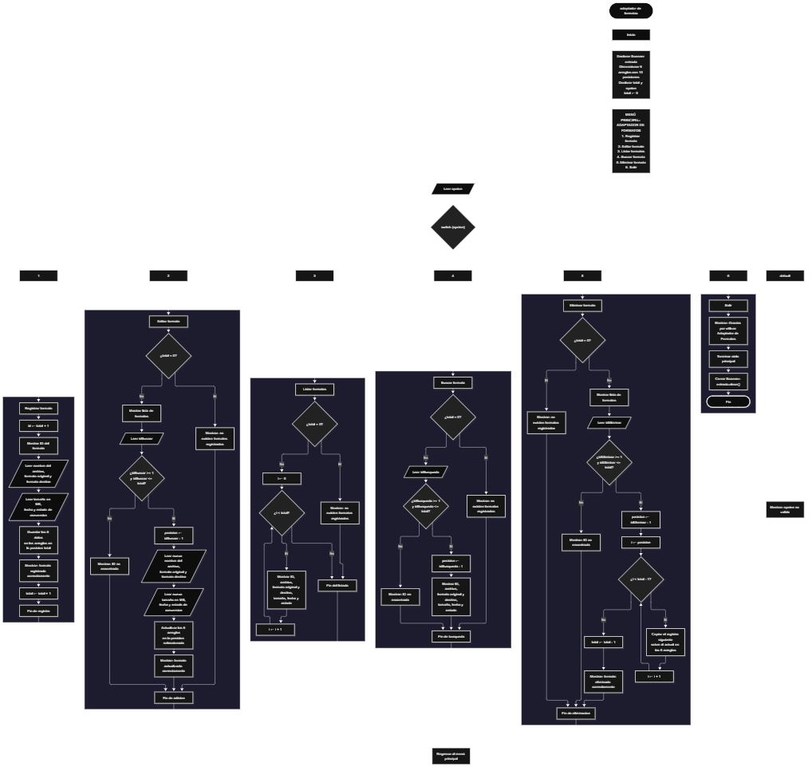

 

Este proyecto, llamado <b>adaptador de formatos</b>, fue desarrollado en <b>java</b> como un ejercicio práctico para fortalecer la lógica de programación mediante la creación de un sistema de gestión de formatos de archivos desde la consola. El programa cuenta con un menú principal de seis opciones que permite <b>registrar, editar, listar, buscar y eliminar</b> los formatos almacenados, además de finalizar su ejecución. Cada registro almacena información como el nombre del archivo, el formato original, el formato de destino, el tamaño en megabytes, la fecha de conversión y el estado de la conversión, utilizando arreglos con una capacidad máxima de <b>10 registros durante la ejecución</b>. Durante su desarrollo se aplicaron conceptos fundamentales de programación, como variables, arreglos, estructuras condicionales, ciclos repetitivos y estructuras de selección, además de procesos para consultar, modificar, eliminar y organizar registros. Este proyecto permite poner en práctica los conocimientos adquiridos en Java y sirve como base para desarrollar sistemas de gestión más avanzados utilizando otros lenguajes y tecnologías.

<h2 align="center">⚙️ Funcionamiento del menú principal</h2>

### ➕ Registrar formato

La opción <b>1) registrar formato</b> permite almacenar la información de un archivo y los datos relacionados con su conversión. Primero, el programa calcula el ID del nuevo registro mediante la expresión <b>total + 1</b>, mostrando el número que le corresponde. Después, solicita el <b>nombre del archivo, formato original, formato de destino, tamaño del archivo en MB, fecha de conversión y estado de la conversión</b>. Los datos se almacenan en la posición correspondiente de sus respectivos arreglos: <b>archivos, formatosOriginales, formatosDestino, tamanos, fechas y estados</b>. Finalmente, muestra el mensaje <b>"Formato registrado correctamente."</b> e incrementa la variable <b>total</b> en uno para actualizar la cantidad de registros almacenados.

### ✏️ Editar formato

La opción <b>2) editar formato</b> permite modificar la información de un formato registrado. Primero, el programa comprueba si existen registros almacenados mediante la condición <b>total == 0</b>. Si no hay formatos registrados, muestra el mensaje <b>"No existen formatos registrados."</b>. En caso contrario, presenta una lista con el ID, nombre del archivo, formato original, formato de destino, tamaño, fecha y estado de cada registro. Después, solicita el ID del formato que se desea editar y comprueba que esté dentro del rango permitido mediante la condición <b>idBuscar &gt;= 1 && idBuscar &lt;= total</b>. Si la selección es válida, calcula la posición mediante <b>idBuscar - 1</b> y solicita los nuevos datos del archivo, actualizando directamente los valores de los seis arreglos correspondientes. Finalmente, presenta el mensaje <b>"Formato actualizado correctamente."</b>. Si el ID introducido no corresponde a un formato registrado, muestra el mensaje <b>"ID no encontrada."</b>.

### 🗑️ Eliminar formato

La opción <b>5) eliminar formato</b> permite eliminar un formato registrado mediante su ID. Antes de comenzar, el programa comprueba si existen registros almacenados. Si no hay formatos registrados, muestra el mensaje <b>"No existen formatos registrados."</b>. Si hay registros disponibles, presenta una lista con los datos de cada formato. Después, solicita el ID que se desea eliminar y verifica que la selección esté dentro del rango válido mediante la condición <b>idEliminar &gt;= 1 && idEliminar &lt;= total</b>. Si el formato existe, calcula su posición mediante <b>idEliminar - 1</b> y comienza el proceso de eliminación. Para mantener los registros organizados, utiliza un ciclo <b>for</b> controlado por la variable <b>i</b>, que desplaza una posición hacia la izquierda los datos posteriores en los seis arreglos: <b>archivos, formatosOriginales, formatosDestino, tamanos, fechas y estados</b>. Posteriormente, disminuye la variable <b>total</b> en uno y muestra el mensaje <b>"Formato eliminado correctamente."</b>. Si el ID seleccionado no corresponde a un formato registrado, informa mediante el mensaje <b>"ID no encontrada."</b>.

### 🔎 Buscar formato

La opción <b>4) buscar formato</b> permite localizar un formato mediante su ID. Primero, el programa comprueba si existen formatos registrados utilizando la condición <b>total == 0</b>. Si no hay registros, muestra el mensaje <b>"No existen formatos registrados."</b>. En caso contrario, solicita el ID del formato que se desea buscar y comprueba que esté dentro del rango permitido mediante la condición <b>idBusqueda &gt;= 1 && idBusqueda &lt;= total</b>. Si el ID es válido, calcula la posición correspondiente mediante <b>idBusqueda - 1</b> y muestra todos los datos del formato encontrado: <b>nombre del archivo, formato original, formato de destino, tamaño en MB, fecha y estado de la conversión</b>. Si el ID introducido no corresponde a un registro existente, presenta el mensaje <b>"ID no encontrada."</b>.

### 📋 Listar formatos

La opción <b>3) listar formatos</b> permite visualizar todos los formatos registrados actualmente en el programa. Antes de mostrar la información, comprueba si la variable <b>total</b> es igual a cero. Si no existen registros, presenta el mensaje <b>"No existen formatos registrados."</b>. Si hay formatos disponibles, utiliza un ciclo <b>for</b> para recorrer los arreglos desde la primera posición hasta el número total de registros almacenados. Durante el recorrido, muestra el ID, nombre del archivo, formato original, formato de destino, tamaño en MB, fecha y estado de la conversión de cada registro. El ID se obtiene mediante la expresión <b>i + 1</b>. Esta función facilita consultar los registros existentes sin necesidad de buscar cada formato individualmente.

### 🚪 Salir del menú principal

La opción <b>6) salir</b> está destinada a finalizar la ejecución del programa y muestra el mensaje <b>"Gracias por utilizar Adaptador de Formatos."</b>. El menú principal se encuentra dentro de una estructura repetitiva <b>do-while</b>, que mantiene el programa en funcionamiento mientras la opción seleccionada sea diferente de <b>6</b>. Cuando el usuario selecciona esta opción, el ciclo termina y posteriormente se cierra el objeto <b>Scanner</b> mediante la instrucción <b>entrada.close()</b>, finalizando la ejecución del programa.

<h2 align="center">🧠 Temas aplicados en el proyecto</h2>

### 📦 Variables

En este proyecto se utilizan variables para almacenar la cantidad de formatos registrados, controlar la opción seleccionada en el menú, calcular los identificadores, seleccionar las posiciones de los registros que se desean editar, buscar o eliminar y controlar los recorridos de los arreglos. Cada variable cumple una función específica dentro de las operaciones de gestión de formatos.

🔢 **Opcion:** Almacena la opción seleccionada por el usuario en el menú principal.

📊 **Total:** Almacena la cantidad actual de formatos registrados.

🆔 **Id:** Calcula el identificador del nuevo formato mediante la expresión `total + 1`.

🔎 **IdBuscar:** Almacena el identificador del formato que se desea editar.

🔍 **IdBusqueda:** Almacena el identificador del formato que se desea buscar.

🗑️ **IdEliminar:** Almacena el identificador del formato que se desea eliminar.

📍 **Posicion:** Almacena la posición del arreglo correspondiente al formato seleccionado.

🔄 **I:** Funciona como contador en los ciclos `for` y permite recorrer los arreglos, mostrar registros y desplazar los datos durante la eliminación.

### 🗃️ Arreglos

En este proyecto se utilizan seis arreglos relacionados con la información de cada formato. Cada arreglo tiene una capacidad de <b>10 posiciones</b> y utiliza el mismo índice para representar los datos correspondientes a un mismo registro. Por ejemplo, la información de un formato almacenado en la posición <b>0</b> se encuentra distribuida entre <b>archivos[0], formatosOriginales[0], formatosDestino[0], tamanos[0], fechas[0] y estados[0]</b>. Esta organización permite recorrer, buscar, modificar, mostrar y eliminar los registros de manera ordenada.

📁 **Archivos[10]:** Almacena los nombres de los archivos registrados.

📄 **FormatosOriginales[10]:** Almacena los formatos originales de los archivos.

🔄 **FormatosDestino[10]:** Almacena los formatos de destino de los archivos.

📊 **Tamanos[10]:** Almacena los tamaños de los archivos en megabytes utilizando el tipo de dato `double`.

📅 **Fechas[10]:** Almacena las fechas de conversión de los archivos.

⚙️ **Estados[10]:** Almacena los estados de las conversiones registradas.

### 🔀 Estructuras condicionales

En este proyecto se utilizan las estructuras <b>if</b> y <b>else</b> para comprobar si existen formatos registrados antes de realizar determinadas operaciones y verificar que el ID introducido por el usuario se encuentre dentro del rango permitido. Estas condiciones permiten que el programa responda de manera diferente según la cantidad de registros almacenados y la validez del identificador seleccionado.

### 🔄 Estructuras repetitivas

En este proyecto se utilizan los ciclos <b>for</b> y <b>do-while</b>. Los ciclos <b>for</b> permiten recorrer los arreglos para mostrar los formatos registrados y acceder a las posiciones correspondientes durante las operaciones de edición, búsqueda y eliminación. Durante la eliminación, también se utilizan para desplazar los datos de los registros posteriores una posición hacia la izquierda. Por otro lado, el ciclo <b>do-while</b> mantiene activo el menú principal para que el usuario pueda ejecutar las diferentes operaciones disponibles hasta seleccionar la opción de salida.

### 🎯 Estructura switch

El programa utiliza la estructura <b>switch</b> para evaluar el valor almacenado en la variable <b>opcion</b> y ejecutar el bloque de instrucciones correspondiente. Cada caso representa una operación específica del sistema: <b>registrar, editar, listar, buscar, eliminar o salir</b>. También se utiliza el bloque <b>default</b> para mostrar el mensaje <b>"Opcion no valida."</b> cuando el usuario introduce un número que no coincide con ninguna de las opciones definidas en el menú.

### 🔢 Dimensionamiento de arreglos

El programa utiliza la creación de arreglos mediante la instrucción <b>new</b> para establecer la capacidad de los espacios donde se almacena la información de los formatos. Se definieron <b>10 posiciones</b> para cada uno de los seis arreglos, lo que permite administrar hasta 10 registros durante la ejecución. La cantidad de posiciones ocupadas se controla mediante la variable <b>total</b>, por lo que las operaciones recorren únicamente los registros comprendidos entre la primera posición y el total actual de formatos.

### 🔄 Reorganización de registros

Cuando se selecciona un formato para eliminarlo, el programa utiliza un ciclo <b>for</b> que comienza en la posición seleccionada y continúa mientras <b>i &lt; total - 1</b>. En cada repetición, los datos de la posición siguiente se copian sobre la posición actual en los seis arreglos: <b>archivos, formatosOriginales, formatosDestino, tamanos, fechas y estados</b>. Después, la variable <b>total</b> disminuye en uno. De esta manera, los registros posteriores ocupan las posiciones disponibles sin dejar espacios vacíos entre los formatos activos. La última posición no se limpia, pero deja de formar parte de los registros contabilizados.

<h2 align="center">¿Cómo se implementaron las operaciones crud en el proyecto?</h2>

Las operaciones <b>crud</b> se implementaron mediante las opciones del menú principal, permitiendo administrar los registros de formatos de archivos. La operación <b>crear</b> corresponde a <b>registrar formato</b>, donde se introducen los datos de un nuevo archivo y su conversión; <b>leer</b> se realiza mediante las opciones <b>buscar formato y listar formatos</b>; <b>actualizar</b> corresponde a <b>editar formato</b>, donde se modifican los datos de un registro existente; y <b>eliminar</b> se realiza mediante la opción <b>eliminar formato</b>. Estas operaciones utilizan variables, arreglos, condicionales y ciclos para gestionar la información almacenada temporalmente durante la ejecución del programa.

<h2 align="center">Diagrama de flujo del proyecto</h2>

<h2 align="center">🛡️ Validaciones del programa</h2>

### 📭 No existen formatos registrados

Esta validación se utiliza en las opciones de <b>editar, listar, buscar y eliminar</b>. El programa comprueba si la variable <b>total</b> es igual a <b>0</b> y, si no existen formatos registrados, muestra el mensaje <b>"No existen formatos registrados."</b>. Esta comprobación evita continuar con las operaciones que necesitan información almacenada cuando no hay registros disponibles.

### 🔢 ID no encontrada

Esta validación se utiliza durante las operaciones de <b>editar, buscar y eliminar</b>. El programa comprueba que el identificador introducido por el usuario sea mayor o igual a <b>1</b> y menor o igual al valor de <b>total</b>. Si el ID se encuentra dentro de ese rango, calcula la posición correspondiente restando uno al identificador. En caso contrario, muestra el mensaje <b>"ID no encontrada."</b>, evitando acceder a una posición que no corresponde a un formato registrado.

### ⚠️ Opción no válida

La estructura <b>switch</b> incluye el bloque <b>default</b>, que muestra el mensaje <b>"Opcion no valida."</b> cuando el usuario introduce un número que no corresponde a ninguna de las opciones definidas en el menú principal. Esta comprobación permite informar al usuario cuando selecciona una opción que no está disponible.

### 📦 Capacidad de los arreglos

Los seis arreglos del programa tienen una capacidad definida de <b>10 posiciones</b>. Sin embargo, en el código actual no se incluye una condición que compruebe si se ha alcanzado esa capacidad antes de registrar un nuevo formato. Por este motivo, el programa no cuenta todavía con una validación que impida agregar registros cuando los arreglos están llenos.

<h2 align="center">🎯 Objetivo del proyecto</h2>

El objetivo principal de este proyecto es fortalecer la <b>lógica de programación</b> mediante el desarrollo de un sistema de gestión de formatos de archivos en <b>java</b>. A través de su construcción se busca aplicar los conocimientos adquiridos sobre variables, arreglos, estructuras condicionales, ciclos repetitivos y estructuras de selección, integrándolos para resolver un problema de manera organizada. Además, el proyecto permite comprender cómo registrar, consultar, modificar y eliminar información mediante un sistema de consola, estableciendo una base para desarrollar aplicaciones de gestión más completas con otros lenguajes y tecnologías.

